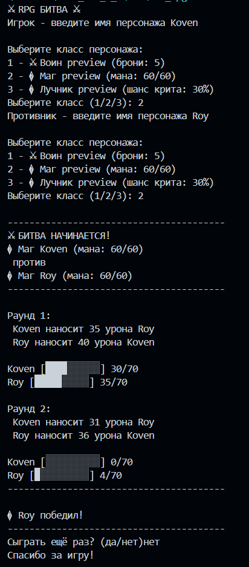

# Лабораторная работа №7. Углублённое ООП в Dart
## Итоговая программа: «RPG-битва»
## Автор: Окишев Максим 
## Группа ИСП-242

## Итоговый проект

## Запуск
1. Клонировать репозиторий: `git clone <url>`
2. Перейти в папку: `cd lab7_RPG_O_G`
3. Установить зависимости: `dart pub get`
4. Запустить: `dart run`

## Что изучили?
1. Классы
2. Наследование
3. Абстрактные классы
4. Переопределение методов — @override

## Ответы на вопросы

**1. Что такое абстрактный класс? Почему нельзя написать Character() напрямую?**

Это класс-заготовка, где часть методов без тела — в `character.dart` так объявлены `attack()` и `toString()`. Наследники обязаны их дописать. `Character()` создать нельзя — не скомпилируется. Потому что непонятно, что должен делать `attack()`.

**2. Зачем нужен super в конструкторе наследника? Что будет если его убрать?**

Он передаёт данные в конструктор родителя. `name` и `hp` живут в `Character`, там же считается `maxHp = hp`, поэтому пишу `super(name: name, hp: 120)`. Если его убрать — не скомпилируется: у `Character` нет пустого конструктора, и Dart не знает, чем заполнять унаследованные поля.

**3. В чём разница между @override у attack() в Warrior и takeDamage() в Warrior? Почему второй переопределяет метод который уже имеет реализацию в родителе?**

Сам `@override` одинаковый — это пометка, чтобы компилятор проверил наличие такого метода у родителя, на работу она не влияет. Разница в родителе: `attack()` абстрактный, тела нет, `Warrior` пишет его с нуля. А `takeDamage()` уже рабочий — отнимает hp и не даёт уйти в минус, `Warrior` переопределяет его только ради брони и зовёт `super.takeDamege(reduced)`, чтобы не копировать чужую логику.

**4. Функция fight(Character a, Character b) не знает кто реально придёт — Warrior, Mage или Archer. Как называется эта концепция и где вы её уже видели во Flutter?**

Полиморфизм. Функция работает с типом `Character`, а `attack()` выполняет код того класса, что реально пришёл. Во Flutter так же с Widget: build() возвращает Widget, а возвращают из него Text, Container или Column — и всё рисуется одинаково.

**5. Что означает _random с нижним подчёркиванием в классе Character?**

Приватное поле на уровне файла: видно только внутри `character.dart`, из `characters.dart` или `battle.dart` его не достать. 

